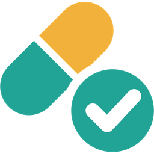

<p align="center">
  
</p>

# MedTrack

Medication reminders and stock tracking for Home Assistant, with actionable
notifications on iPhone and iPad (iOS / iPadOS) through the Home Assistant
Companion App.

- Reminders with **Taken**, **Snooze** and **Skip** buttons, sent to every
  phone you choose. Taking a dose on one phone clears the reminder on the others.
- Repeats until you respond, then marks the dose **missed** (with a
  **Taken late** button).
- Tracks stock, shows days remaining, and alerts once when stock runs low,
  with a **Refilled** button.
- Permanent dose history (survives Home Assistant's recorder purge), with
  undo and a `get_history` action for dashboards and automations.
- A **MedTrack Today** dashboard card with today's doses, Taken, Snooze,
  Skip, Undo and Refill.
- Everything is set up in the UI; no YAML.

> [!WARNING]
> Do not rely on MedTrack as your only reminder for critical medication. If
> Home Assistant, your internet connection or Apple's push service is down at
> dose time, no reminder arrives. Keep a phone alarm as a backup.

## Requirements

- Home Assistant 2026.10 or newer.
- The Home Assistant Companion App on each iPhone or iPad, signed in to your
  Home Assistant with notifications allowed. An Apple Watch shows the
  reminders mirrored from the iPhone. Android is not supported in this
  version.
- To install it: the built-in **Marketplace** (Home Assistant 2026.11 and
  newer) or [HACS](https://hacs.xyz) (Home Assistant 2026.10).

## Installation

### Home Assistant 2026.11 and newer: Marketplace

From 2026.11, HACS is built into Home Assistant as the **Marketplace**
(**Settings → Marketplace**). MedTrack is installed and updated there as a
custom repository.

1. Open **Settings → Marketplace** and add
   `https://github.com/s-greg/ha-medtrack` as a custom repository of type
   **Integration**.
2. Open **MedTrack** in the Marketplace and download it.
3. Restart Home Assistant (**Settings → System → Restart**).
4. **Settings → Devices & services → Add integration → MedTrack.**

**Connect the Marketplace to GitHub.** For repositories added by link, the
Marketplace looks for new releases through GitHub (about every 48 hours), and
only when it has a GitHub connection. Without it, MedTrack updates do not
appear under **Settings → Updates**.

Already installed MedTrack through HACS? HACS installs, including custom
repositories, move to the Marketplace automatically on the first start after
upgrading to 2026.11. Check afterwards that MedTrack is listed under
**Settings → Marketplace**.

### Home Assistant 2026.10: HACS

1. In Home Assistant, open **HACS**.
2. Open the menu (⋮, top right) → **Custom repositories**.
3. Repository: `https://github.com/s-greg/ha-medtrack`, type: **Integration**,
   then **Add**.
4. Search HACS for **MedTrack**, open it and select **Download**.
5. Restart Home Assistant (**Settings → System → Restart**).
6. **Settings → Devices & services → Add integration → MedTrack.**

Updates appear in HACS like any other integration.

### Manual installation

Copy `custom_components/medtrack` into the `custom_components` folder of your
Home Assistant configuration and restart.

## Setup

**Hub settings** (the first form, later under **Configure**):

| Setting | Meaning |
|---|---|
| Phones to notify | Every reminder goes to all selected phones |
| Re-remind interval | Minutes between repeated reminders (default 10) |
| Max reminders | Reminders per dose, including the first; then the dose is missed (default 4) |
| Max snoozes per dose / Snooze length | Default 3 snoozes of 15 minutes |
| Early-take window | How early a dose may be confirmed or skipped (default 60 minutes) |
| Interruption level | *Time sensitive* breaks through Focus modes |
| Require unlock for "Taken" | The phone must be unlocked before Taken counts |
| Critical alert volume | Volume of critical alerts (see below) |
| History retention | Days of history to keep; 0 keeps everything |
| Page to open when tapping a reminder | Empty: the medication's device page |

**Medications:** on the MedTrack integration page select **Add medication**.
Name, dose amount and unit (for example 2 tablet), times, days and optional
instructions ("with food"). Fill in **Current stock** to track stock; leave it
empty to not track stock. Optionally a **Low-stock threshold**, a **Default
refill amount**, **Critical alerts** (never, final reminder only, all
reminders) and per-medication reminder overrides. Edit a medication with its
⋮ menu → **Edit medication**; changing the stock there is logged as a correction.

**Critical alerts** sound even when the phone is muted or in a Focus mode.
Check that they are allowed on each iPhone and iPad: **Settings → Notifications → Home
Assistant → Critical Alerts**.

## Entities (per medication)

| Entity | Shows / does |
|---|---|
| Stock, Days remaining, Low stock | Only with stock tracking |
| Next dose | Time of the next dose |
| Status | Idle, pending, snoozed, taken, taken late, skipped or missed |
| Taken today | Doses taken today (attribute: due today) |
| Last action | What Undo would revert, for example "Taken 08:02" |
| Take, Skip, Snooze | Act on the running dose, or (Take, Skip) on one within the early-take window |
| Undo last | Reverts the last take, skip or refill (last 24 hours) |
| Refill amount, Refill | Type an amount and press Refill; only with stock tracking |

The hub device has **Doses due today** and **Doses taken today**.
Tapping a reminder opens the medication's device page, where these buttons are.

## Dashboard card: MedTrack Today

Today's doses as a timeline, with a progress ring ("3 of 5 doses taken
today") and a banner when a medication runs low.

- A due or snoozed dose shows **Taken**, **Snooze** and **Skip**, and which
  reminder it is on.
- Tap an upcoming dose to **Take early** or **Skip** it (within the
  early-take window).
- A missed dose offers **Taken late**. Doses taken late get an amber
  check, so they stand out from doses taken on time.
- Tap a taken or skipped dose, or a refill, to **Undo** it (with a
  confirmation).
- **Refill** opens a dialog prefilled with the default refill amount.

The card updates by itself when anything changes, also when the change came
from a phone notification.

**Adding it:** edit a dashboard → **Add card** → search for **MedTrack
Today**. With more than one MedTrack hub, choose the hub in the card editor.
In YAML:

```yaml
type: custom:medtrack-today-card
entry_id: 01JC...   # optional; only needed with more than one hub
```

The card comes with the integration and is loaded automatically: there is
nothing to add under **Dashboards → Resources**, and an update replaces it
together with the integration. The Companion App loads the new version on its
own, because every version has its own address.

> [!NOTE]
> A dashboard opened while Home Assistant is still starting can show
> "Custom element doesn't exist: medtrack-today-card". Reload the page once
> Home Assistant has finished starting (on iPhone: pull down on the
> dashboard).

## Actions

All actions target one medication by its device or one of its entities,
except `get_day`.

| Action | Fields |
|---|---|
| `medtrack.take_dose` | `dose_id` (optional) |
| `medtrack.skip_dose` | `dose_id` (optional) |
| `medtrack.snooze_dose` | `minutes` (optional) |
| `medtrack.refill` | `amount` (optional, default refill amount) |
| `medtrack.set_stock` | `amount` |
| `medtrack.undo_last` | |
| `medtrack.get_history` | `start`, `end` (optional); returns the records |
| `medtrack.get_day` | `config_entry_id` (optional with one hub); returns today's doses, refills and stock, as used by the card |

Events for automations: `medtrack_dose_pending`, `medtrack_dose_snoozed`,
`medtrack_dose_taken`, `medtrack_dose_taken_late`, `medtrack_dose_skipped`,
`medtrack_dose_missed`, with `medication`, `dose_id`, `scheduled_at`, `at`
and `user_id`.

Example: get this week's history.

```yaml
action: medtrack.get_history
target:
  entity_id: sensor.vitamin_d_status
data:
  start: "2026-11-02 00:00:00"
response_variable: history
```

## Good to know

- **Remote access is needed for the buttons.** Tapping Taken, Snooze or Skip
  sends the answer from the iPhone or iPad to Home Assistant. Away from home that only
  works through Home Assistant Cloud (Nabu Casa), a reverse proxy, or a VPN
  that is connected at that moment. If the phone cannot reach Home Assistant,
  the tap is lost and the reminders keep coming.
- **The iOS snooze options are not MedTrack's.** iOS adds its own snooze
  choices to every notification. Home Assistant never hears about those, so
  MedTrack keeps reminding. Use MedTrack's own **Snooze** button.
- **Notification limit.** Apple allows 500 notifications per phone per day
  (critical alerts excluded). MedTrack shows a warning under **Settings →
  Repairs** if your settings could exceed 400 in the worst case.
- **Phone renamed or removed?** Its notification service changes name and it
  stops getting reminders. A Repairs issue tells you; select the phone again
  under **Configure**.
- **Changing a unit** (tablet → capsule) can make Home Assistant report a
  unit change for the Stock statistics; fix it under **Developer tools →
  Statistics**.
- **After a restart** MedTrack resumes the most recent dose that is still in
  its reminder window. Older doses that came due while Home Assistant was off
  are marked missed without notifications, so you never get a burst.
- **Diagnostics** (integration ⋮ → Download diagnostics) contain your
  medication settings and recent history, but no phone names or user IDs.
  Check the file before sharing it.

## Privacy

Everything stays in your own Home Assistant: medication settings in its
configuration, doses and history in `.storage/medtrack.<entry_id>`. MedTrack
makes no internet connections of its own; notifications go through the
Companion App's normal push service.

## License

[MIT](LICENSE)
